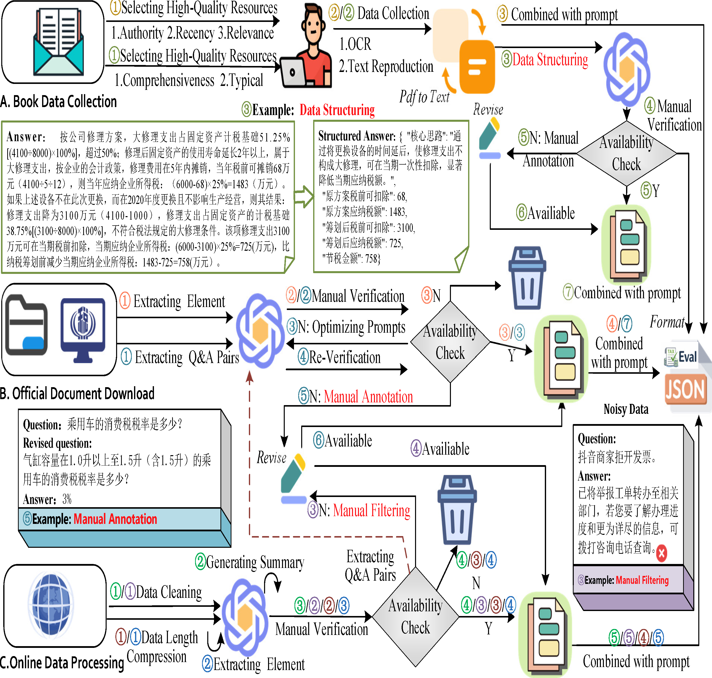
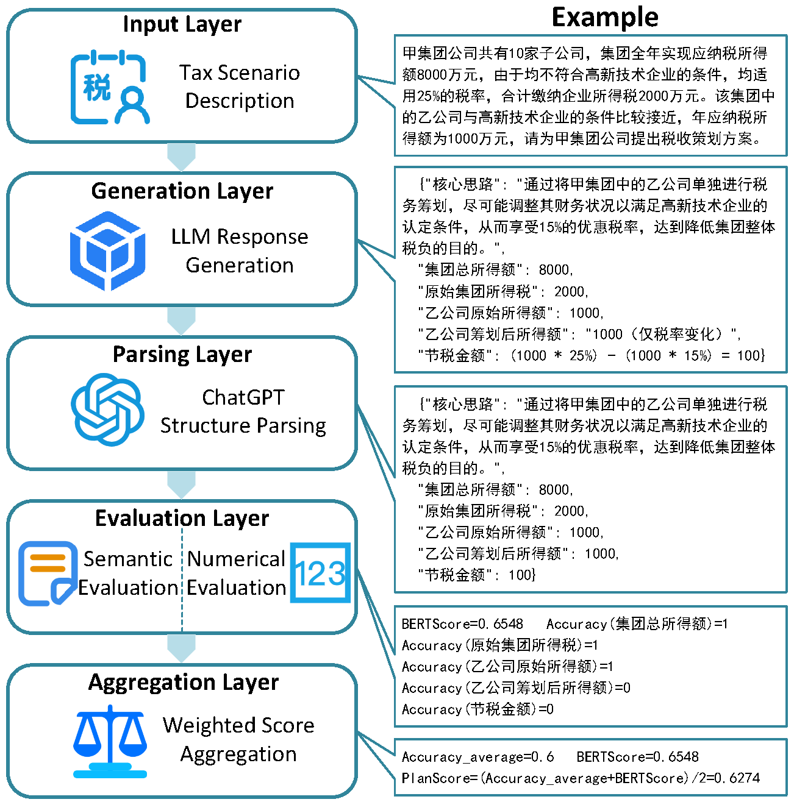
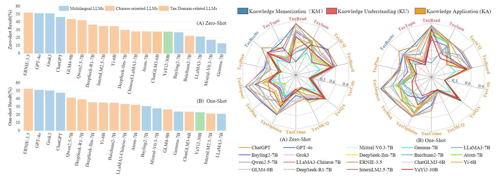
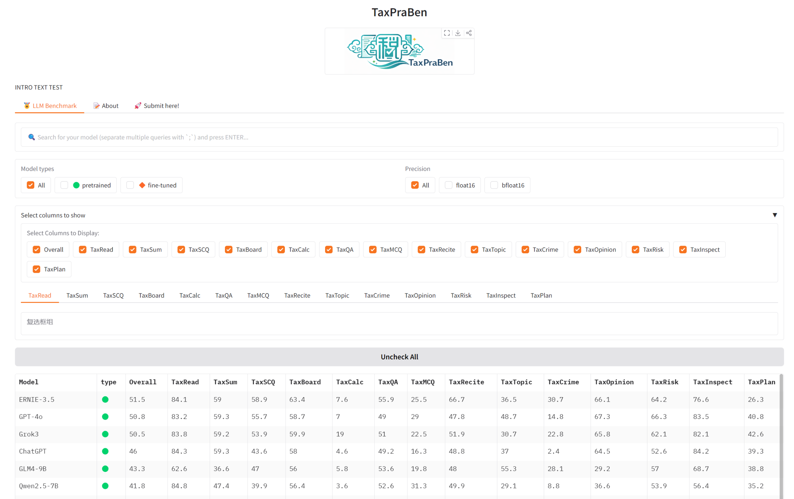

# TaxPraBen：面向中文真实税务实践的可扩展结构化评测基准

[English](README_en.md) | [中文](README.md)


<p align="center">
  <a href="#overview">📘 项目简介</a> •
  <a href="#benchmark">🧭 基准概览</a> •
  <a href="#structured-eval">🧩 结构化评估</a> •
  <a href="#quickstart">🚀 快速开始</a> •
  <a href="#results">📈 评测结果</a>
</p>
---

<a id="overview"></a>
## 📘 1. 项目简介
**TaxPraBen** 是一个面向“真实中文税务实践”的可扩展评测基准，覆盖从税务知识记忆到税务政策理解、再到真实场景下的税务计算与税收筹划等多层次能力，并提供 **结构化评估** 方案，以支持对生成式输出的自动化、可复现评测。

- 🎯 **目标**：面向真实税务业务场景，评估 LLM 在中文税务领域的“能不能用、用得准不准、输出结构是否可靠”
- 🧩 **关键特点**：多源数据构建，任务分层（KM/KU/KA），结构化输出，语义/数值联合打分


---

<a id="benchmark"></a>
## 🧭 2. 基准概览
### 2.1 任务分层

TaxPraBen 将税务能力划分为三层任务类型：

- **KM（知识记忆）**：检验模型对税务法条/概念等知识的记忆与复述能力  
- **KU（知识理解）**：检验模型对税务政策与文本信息的理解能力  
- **KA（知识应用）**：检验模型在真实业务情境下的计算、问答、风险识别、稽查要素抽取与税收筹划能力  

### 2.2 数据集与任务

本基准共包含 **14 个数据集**：

- **KM**：TaxRecite  
- **KU**：TaxSum / TaxTopic / TaxRead  
- **KA**：TaxCalc / TaxSCQ / TaxMCQ / TaxQA / TaxBoard / TaxCrime / TaxOpinion / TaxRisk / TaxInspect / TaxPlan

### 2.3 数据构建流程

我们采用 **多源数据融合** 的方式构建 TaxPraBen，整体包含三条数据获取/处理管线：

- **A. 书籍数据收集**：  

  从权威税务教材/辅导书/案例集等来源整理题目与案例。对题库类数据（如单选、多选、计算）进行规范化抽取；对税收筹划类案例进行结构化要素抽取与人工核验，以保证场景真实性与字段一致性。

- **B. 官方文档下载**：  
  
  从税务机关等官方渠道获取政策法规与公告文本，并结合提示工程与模型辅助生成/清洗（如法条背诵、问答等），再进行人工复核，确保内容权威性与可用性。
  
- **C. 在线数据处理**：  
  
  从公开网络来源收集税务新闻、稽查/风险案例、税务舆情与留言问答等，并通过去噪、压缩、结构化抽取与质量筛选等步骤，形成适配评测的样本。

<p align="center">
  
</p>

<a id="structured-eval"></a>
## 🧩 3. 结构化评估流程（以TaxPlan为例）
本基准TaxPlan数据集采用结构化评估：要求模型输出满足可解析的结构，并在此基础上进行 **语义一致性评估，数值字段准确性评估，统一聚合**。

### 3.1 TaxPlan 输出模板（JSON）

TaxPlan 要求模型输出可解析 JSON。示例如下：


```json
 {"核心思路": "通过将更换设备的时间延后，使修理支出不构成大修理，可在当期一次性扣除，显著降低当期应纳税额。",
  "原方案税前可扣除": 68,
  "原方案应纳税额": 1483,
  "筹划后税前可扣除": 3100,
  "筹划后应纳税额": 725,
  "节税金额": 758}
```

### 3.2 评估流程

1. **输入层**：给定税务场景描述
2. **生成层**：LLM 生成回答
3. **解析层**：将模型输出解析为结构化字段
4. **评估层**：  
   - 对文本字段做语义相似度评估
   - 对数值字段进行准确性评估
5. **聚合层**：将语义与数值评估结果进行加权，输出最终得分

<p align="center">
  
</p>

<a id="quickstart"></a>
## 🚀 4. 快速开始
### 4.1 本地安装

```bash
cd TaxPraBen
pip install -r requirements.txt
cd src/tax-evaluation
pip install -e .[multilingual]
```

### 4.2 自动化任务评测

在开始评测前，请先下载 **BART checkpoint** 并放置到：

```text
src/metrics/BARTScore/bart_score.pth
```

随后根据你的模型类型选择评测方式：

#### 方式 1：HuggingFace Transformer

用于评测 HuggingFace Hub 上的模型：

```bash
python eval.py \
  --model "hf-causal-llama" \
  --model_args "use_accelerate=True,pretrained=PoLylm-13B,tokenizer=PoLylm-13B,use_fast=False" \
  --tasks "TaxPraBen_TaxRecite"
```

#### 方式 2：商业 API

```bash
export OPENAI_API_SECRET_KEY=YOUR_KEY_HERE
python eval.py \
  --model chatgpt \
  --tasks TaxPraBen_TaxRecite
```

#### 方式 3：自托管评测

启动推理后端：

```bash
bash scripts/run_interface.sh
```

根据你的环境需求调整 `run_interface.sh`。

开始评测：

```bash
python data/*/evaluate.py
```

<a id="results"></a>
## 📈 5. 评测结果
### 5.1 模型综合表现

<p align="center">
  
</p>

- **闭源商用模型整体更强**：在多项任务上，闭源模型（如 GPT 系列、ERNIE 等）总体得分更高，体现出更好的中文理解与复杂税务场景适配能力。  
- **中文取向开源模型通常优于多语通用模型**：面向中文优化/训练的模型在中文税务任务上更占优势；多语通用模型在专业细粒度任务上容易失分。  
- **One-shot 并非总是提升**：加入示例往往能改善部分模型的输出与可解析性，但对少数模型可能带来退化（如上下文变长、格式偏移等），需要结合任务与模型特性选择提示策略。

### 5.2 基准评测排行榜

为实现对税务导向大语言模型的透明、标准化比较，我们构建了TaxPraBen开放排行榜，支持模型提交、自动化评测以及交互式结果可视化。

<p align="center">
  
</p>

### 5.3 指标明细表

本节提供 **Zero-shot** 与 **One-shot** 的逐任务逐指标结果表。

<div align="center"><b>Zero-shot 详细结果</b></div>
<div style="overflow-x:auto;">
<table>
<thead><tr>
<th>Task</th>
<th>Dataset</th>
<th>Metrics</th>
<th>ChatGPT</th>
<th>GPT-4o</th>
<th>Mistral-V0.3</th>
<th>Gemma</th>
<th>LLaMA3</th>
<th>Bayling2</th>
<th>Grok3</th>
<th>DeepSeek-llm</th>
<th>Baichuan2</th>
<th>Atom</th>
<th>Qwen2.5</th>
<th>ChineseLLaMA3</th>
<th>ERNIE-3.5</th>
<th>ChatGLM3</th>
<th>Yi</th>
<th>GLM4</th>
<th>DeepSeek-R1</th>
<th>InternLM2.5</th>
<th>YaYi2</th>
</tr></thead>
<tbody>
<tr>
<td>KM</td>
<td>TaxRecite</td>
<td>BERTScore</td>
<td>0.493</td>
<td>0.475</td>
<td>0.390</td>
<td>0.224</td>
<td>0.390</td>
<td>0.465</td>
<td>0.537</td>
<td>0.504</td>
<td>0.470</td>
<td>0.479</td>
<td>0.502</td>
<td>0.428</td>
<td>0.721</td>
<td>0.493</td>
<td>0.489</td>
<td>0.481</td>
<td>0.454</td>
<td>0.518</td>
<td>0.491</td>
</tr>
<tr>
<td>KM</td>
<td>TaxRecite</td>
<td>BARTScore</td>
<td>-5.166</td>
<td>-5.195</td>
<td>-5.903</td>
<td>-7.357</td>
<td>-5.657</td>
<td>-5.331</td>
<td>-4.991</td>
<td>-5.162</td>
<td>-5.306</td>
<td>-5.304</td>
<td>-5.044</td>
<td>-5.367</td>
<td>-3.869</td>
<td>-5.189</td>
<td>-5.245</td>
<td>-5.221</td>
<td>-5.327</td>
<td>-5.073</td>
<td>-5.220</td>
</tr>
<tr>
<td>KU</td>
<td>TaxSum</td>
<td>BERTScore</td>
<td>0.624</td>
<td>0.621</td>
<td>0.043</td>
<td>0.234</td>
<td>0.360</td>
<td>0.524</td>
<td>0.620</td>
<td>0.541</td>
<td>0.413</td>
<td>0.464</td>
<td>0.471</td>
<td>0.552</td>
<td>0.618</td>
<td>0.336</td>
<td>0.549</td>
<td>0.331</td>
<td>0.536</td>
<td>0.432</td>
<td>0.331</td>
</tr>
<tr>
<td>KU</td>
<td>TaxSum</td>
<td>BARTScore</td>
<td>-4.378</td>
<td>-4.362</td>
<td>-6.826</td>
<td>-7.288</td>
<td>-5.934</td>
<td>-5.003</td>
<td>-4.364</td>
<td>-4.907</td>
<td>-5.523</td>
<td>-5.380</td>
<td>-5.234</td>
<td>-4.794</td>
<td>-4.389</td>
<td>-5.965</td>
<td>-4.775</td>
<td>-5.994</td>
<td>-4.932</td>
<td>-5.444</td>
<td>-6.058</td>
</tr>
<tr>
<td>KU</td>
<td>TaxTopic</td>
<td>Accuracy</td>
<td>0.442</td>
<td>0.556</td>
<td>0.152</td>
<td>0.000</td>
<td>0.222</td>
<td>0.054</td>
<td>0.346</td>
<td>0.128</td>
<td>0.146</td>
<td>0.211</td>
<td>0.340</td>
<td>0.193</td>
<td>0.424</td>
<td>0.116</td>
<td>0.210</td>
<td>0.630</td>
<td>0.226</td>
<td>0.434</td>
<td>0.004</td>
</tr>
<tr>
<td>KU</td>
<td>TaxTopic</td>
<td>F1</td>
<td>0.402</td>
<td>0.559</td>
<td>0.092</td>
<td>0.000</td>
<td>0.094</td>
<td>0.084</td>
<td>0.368</td>
<td>0.071</td>
<td>0.083</td>
<td>0.093</td>
<td>0.356</td>
<td>0.095</td>
<td>0.416</td>
<td>0.147</td>
<td>0.097</td>
<td>0.618</td>
<td>0.143</td>
<td>0.437</td>
<td>0.007</td>
</tr>
<tr>
<td>KU</td>
<td>TaxTopic</td>
<td>Macro F1</td>
<td>0.267</td>
<td>0.346</td>
<td>0.039</td>
<td>0.000</td>
<td>0.039</td>
<td>0.035</td>
<td>0.207</td>
<td>0.030</td>
<td>0.034</td>
<td>0.038</td>
<td>0.177</td>
<td>0.039</td>
<td>0.255</td>
<td>0.054</td>
<td>0.041</td>
<td>0.411</td>
<td>0.057</td>
<td>0.254</td>
<td>0.005</td>
</tr>
<tr>
<td>KU</td>
<td>TaxRead</td>
<td>Accuracy</td>
<td>0.843</td>
<td>0.832</td>
<td>0.558</td>
<td>0.001</td>
<td>0.207</td>
<td>0.658</td>
<td>0.838</td>
<td>0.421</td>
<td>0.210</td>
<td>0.533</td>
<td>0.848</td>
<td>0.291</td>
<td>0.841</td>
<td>0.806</td>
<td>0.694</td>
<td>0.626</td>
<td>0.702</td>
<td>0.000</td>
<td>0.554</td>
</tr>
<tr>
<td>KA</td>
<td>TaxCalc</td>
<td>Accuracy</td>
<td>0.046</td>
<td>0.070</td>
<td>0.000</td>
<td>0.000</td>
<td>0.002</td>
<td>0.004</td>
<td>0.190</td>
<td>0.004</td>
<td>0.000</td>
<td>0.006</td>
<td>0.036</td>
<td>0.002</td>
<td>0.076</td>
<td>0.018</td>
<td>0.024</td>
<td>0.058</td>
<td>0.024</td>
<td>0.042</td>
<td>0.002</td>
</tr>
<tr>
<td>KA</td>
<td>TaxSCQ</td>
<td>Accuracy</td>
<td>0.436</td>
<td>0.556</td>
<td>0.079</td>
<td>0.129</td>
<td>0.231</td>
<td>0.147</td>
<td>0.541</td>
<td>0.259</td>
<td>0.323</td>
<td>0.264</td>
<td>0.407</td>
<td>0.226</td>
<td>0.589</td>
<td>0.283</td>
<td>0.307</td>
<td>0.460</td>
<td>0.230</td>
<td>0.607</td>
<td>0.346</td>
</tr>
<tr>
<td>KA</td>
<td>TaxSCQ</td>
<td>F1</td>
<td>0.436</td>
<td>0.557</td>
<td>0.067</td>
<td>0.166</td>
<td>0.128</td>
<td>0.145</td>
<td>0.538</td>
<td>0.209</td>
<td>0.319</td>
<td>0.199</td>
<td>0.394</td>
<td>0.092</td>
<td>0.589</td>
<td>0.279</td>
<td>0.251</td>
<td>0.475</td>
<td>0.133</td>
<td>0.614</td>
<td>0.345</td>
</tr>
<tr>
<td>KA</td>
<td>TaxSCQ</td>
<td>Macro F1</td>
<td>0.437</td>
<td>0.557</td>
<td>0.072</td>
<td>0.167</td>
<td>0.134</td>
<td>0.148</td>
<td>0.538</td>
<td>0.213</td>
<td>0.320</td>
<td>0.202</td>
<td>0.395</td>
<td>0.098</td>
<td>0.589</td>
<td>0.281</td>
<td>0.255</td>
<td>0.474</td>
<td>0.138</td>
<td>0.614</td>
<td>0.344</td>
</tr>
<tr>
<td>KA</td>
<td>TaxMCQ</td>
<td>Accuracy</td>
<td>0.163</td>
<td>0.290</td>
<td>0.003</td>
<td>0.000</td>
<td>0.000</td>
<td>0.013</td>
<td>0.225</td>
<td>0.020</td>
<td>0.060</td>
<td>0.053</td>
<td>0.313</td>
<td>0.015</td>
<td>0.255</td>
<td>0.030</td>
<td>0.375</td>
<td>0.198</td>
<td>0.020</td>
<td>0.310</td>
<td>0.005</td>
</tr>
<tr>
<td>KA</td>
<td>TaxQA</td>
<td>BERTScore</td>
<td>0.477</td>
<td>0.470</td>
<td>0.373</td>
<td>0.243</td>
<td>0.407</td>
<td>0.477</td>
<td>0.487</td>
<td>0.480</td>
<td>0.458</td>
<td>0.460</td>
<td>0.508</td>
<td>0.457</td>
<td>0.531</td>
<td>0.491</td>
<td>0.479</td>
<td>0.538</td>
<td>0.434</td>
<td>0.513</td>
<td>0.508</td>
</tr>
<tr>
<td>KA</td>
<td>TaxQA</td>
<td>BARTScore</td>
<td>-4.922</td>
<td>-4.895</td>
<td>-5.651</td>
<td>-7.287</td>
<td>-5.446</td>
<td>-5.091</td>
<td>-4.675</td>
<td>-4.860</td>
<td>-4.979</td>
<td>-5.051</td>
<td>-4.555</td>
<td>-5.098</td>
<td>-4.126</td>
<td>-4.926</td>
<td>-4.893</td>
<td>-4.649</td>
<td>-5.243</td>
<td>-4.721</td>
<td>-4.999</td>
</tr>
<tr>
<td>KA</td>
<td>TaxBoard</td>
<td>BERTScore</td>
<td>0.636</td>
<td>0.640</td>
<td>0.210</td>
<td>0.234</td>
<td>0.506</td>
<td>0.572</td>
<td>0.653</td>
<td>0.583</td>
<td>0.551</td>
<td>0.576</td>
<td>0.604</td>
<td>0.540</td>
<td>0.688</td>
<td>0.611</td>
<td>0.578</td>
<td>0.598</td>
<td>0.574</td>
<td>0.584</td>
<td>0.532</td>
</tr>
<tr>
<td>KA</td>
<td>TaxBoard</td>
<td>BARTScore</td>
<td>-4.771</td>
<td>-4.648</td>
<td>-6.452</td>
<td>-7.289</td>
<td>-5.330</td>
<td>-4.991</td>
<td>-4.541</td>
<td>-4.882</td>
<td>-5.007</td>
<td>-4.918</td>
<td>-4.766</td>
<td>-5.135</td>
<td>-4.200</td>
<td>-4.862</td>
<td>-4.888</td>
<td>-4.788</td>
<td>-4.981</td>
<td>-4.854</td>
<td>-5.212</td>
</tr>
<tr>
<td>KA</td>
<td>TaxCrime</td>
<td>Accuracy</td>
<td>0.025</td>
<td>0.135</td>
<td>0.000</td>
<td>0.035</td>
<td>0.010</td>
<td>0.010</td>
<td>0.290</td>
<td>0.030</td>
<td>0.025</td>
<td>0.030</td>
<td>0.100</td>
<td>0.015</td>
<td>0.385</td>
<td>0.000</td>
<td>0.080</td>
<td>0.315</td>
<td>0.080</td>
<td>0.030</td>
<td>0.125</td>
</tr>
<tr>
<td>KA</td>
<td>TaxCrime</td>
<td>F1</td>
<td>0.012</td>
<td>0.135</td>
<td>0.000</td>
<td>0.001</td>
<td>0.001</td>
<td>0.001</td>
<td>0.168</td>
<td>0.001</td>
<td>0.002</td>
<td>0.001</td>
<td>0.123</td>
<td>0.001</td>
<td>0.349</td>
<td>0.000</td>
<td>0.079</td>
<td>0.347</td>
<td>0.096</td>
<td>0.002</td>
<td>0.060</td>
</tr>
<tr>
<td>KA</td>
<td>TaxCrime</td>
<td>Macro F1</td>
<td>0.034</td>
<td>0.175</td>
<td>0.000</td>
<td>0.005</td>
<td>0.003</td>
<td>0.004</td>
<td>0.225</td>
<td>0.050</td>
<td>0.005</td>
<td>0.007</td>
<td>0.041</td>
<td>0.005</td>
<td>0.188</td>
<td>0.000</td>
<td>0.042</td>
<td>0.181</td>
<td>0.035</td>
<td>0.007</td>
<td>0.032</td>
</tr>
<tr>
<td>KA</td>
<td>TaxOpinion</td>
<td>BERTScore</td>
<td>0.764</td>
<td>0.807</td>
<td>0.104</td>
<td>0.179</td>
<td>0.237</td>
<td>0.311</td>
<td>0.786</td>
<td>0.499</td>
<td>0.203</td>
<td>0.544</td>
<td>0.384</td>
<td>0.532</td>
<td>0.784</td>
<td>0.078</td>
<td>0.468</td>
<td>0.285</td>
<td>0.650</td>
<td>0.527</td>
<td>0.374</td>
</tr>
<tr>
<td>KA</td>
<td>TaxOpinion</td>
<td>BARTScore</td>
<td>-4.729</td>
<td>-4.614</td>
<td>-7.407</td>
<td>-7.531</td>
<td>-7.238</td>
<td>-6.911</td>
<td>-4.705</td>
<td>-6.007</td>
<td>-7.353</td>
<td>-5.900</td>
<td>-6.531</td>
<td>-5.712</td>
<td>-4.632</td>
<td>-8.019</td>
<td>-6.073</td>
<td>-7.008</td>
<td>-5.351</td>
<td>-5.813</td>
<td>-6.485</td>
</tr>
<tr>
<td>KA</td>
<td>TaxRisk</td>
<td>RiskScore</td>
<td>0.526</td>
<td>0.663</td>
<td>0.063</td>
<td>0.096</td>
<td>0.145</td>
<td>0.157</td>
<td>0.621</td>
<td>0.301</td>
<td>0.097</td>
<td>0.347</td>
<td>0.539</td>
<td>0.413</td>
<td>0.642</td>
<td>0.055</td>
<td>0.267</td>
<td>0.570</td>
<td>0.479</td>
<td>0.314</td>
<td>0.186</td>
</tr>
<tr>
<td>KA</td>
<td>TaxInspect</td>
<td>InspectScore</td>
<td>0.842</td>
<td>0.835</td>
<td>0.061</td>
<td>0.230</td>
<td>0.295</td>
<td>0.288</td>
<td>0.821</td>
<td>0.433</td>
<td>0.085</td>
<td>0.420</td>
<td>0.564</td>
<td>0.335</td>
<td>0.766</td>
<td>0.186</td>
<td>0.461</td>
<td>0.687</td>
<td>0.626</td>
<td>0.616</td>
<td>0.318</td>
</tr>
<tr>
<td>KA</td>
<td>TaxPlan</td>
<td>PlanScore</td>
<td>0.393</td>
<td>0.408</td>
<td>0.075</td>
<td>0.049</td>
<td>0.048</td>
<td>0.078</td>
<td>0.426</td>
<td>0.078</td>
<td>0.066</td>
<td>0.039</td>
<td>0.352</td>
<td>0.094</td>
<td>0.263</td>
<td>0.294</td>
<td>0.016</td>
<td>0.388</td>
<td>0.304</td>
<td>0.039</td>
<td>0.088</td>
</tr>
</tbody></table></div>

<div align="center"><b>One-shot 详细结果</b></div>
<div style="overflow-x:auto;">
<table>
<thead><tr>
<th>Task</th>
<th>Dataset</th>
<th>Metrics</th>
<th>ChatGPT</th>
<th>GPT-4o</th>
<th>Mistral-V0.3</th>
<th>Gemma</th>
<th>LLaMA3</th>
<th>Bayling2</th>
<th>Grok3</th>
<th>DeepSeek-llm</th>
<th>Baichuan2</th>
<th>Atom</th>
<th>Qwen2.5</th>
<th>ChineseLLaMA3</th>
<th>ERNIE-3.5</th>
<th>ChatGLM3</th>
<th>Yi</th>
<th>GLM4</th>
<th>DeepSeek-R1</th>
<th>InternLM2.5</th>
<th>YaYi2</th>
</tr></thead>
<tbody>
<tr>
<td>KM</td>
<td>TaxRecite</td>
<td>BERTScore</td>
<td>0.510</td>
<td>0.511</td>
<td>0.398</td>
<td>0.218</td>
<td>0.374</td>
<td>0.482</td>
<td>0.547</td>
<td>0.470</td>
<td>0.484</td>
<td>0.467</td>
<td>0.495</td>
<td>0.401</td>
<td>0.666</td>
<td>0.342</td>
<td>0.474</td>
<td>0.152</td>
<td>0.454</td>
<td>0.074</td>
<td>0.318</td>
</tr>
<tr>
<td>KM</td>
<td>TaxRecite</td>
<td>BARTScore</td>
<td>-5.161</td>
<td>-5.133</td>
<td>-5.716</td>
<td>-7.399</td>
<td>-5.593</td>
<td>-5.308</td>
<td>-4.940</td>
<td>-5.208</td>
<td>-5.225</td>
<td>-5.325</td>
<td>-5.075</td>
<td>-5.495</td>
<td>-4.281</td>
<td>-5.986</td>
<td>-5.214</td>
<td>-7.014</td>
<td>-5.326</td>
<td>-7.448</td>
<td>-6.191</td>
</tr>
<tr>
<td>KU</td>
<td>TaxSum</td>
<td>BERTScore</td>
<td>0.624</td>
<td>0.629</td>
<td>0.339</td>
<td>0.549</td>
<td>0.426</td>
<td>0.471</td>
<td>0.623</td>
<td>0.576</td>
<td>0.562</td>
<td>0.573</td>
<td>0.264</td>
<td>0.587</td>
<td>0.617</td>
<td>0.200</td>
<td>0.589</td>
<td>0.254</td>
<td>0.534</td>
<td>0.206</td>
<td>0.066</td>
</tr>
<tr>
<td>KU</td>
<td>TaxSum</td>
<td>BARTScore</td>
<td>-4.385</td>
<td>-4.300</td>
<td>-5.579</td>
<td>-4.800</td>
<td>-5.519</td>
<td>-5.308</td>
<td>-4.348</td>
<td>-4.630</td>
<td>-4.638</td>
<td>-4.670</td>
<td>-6.406</td>
<td>-4.566</td>
<td>-4.418</td>
<td>-6.739</td>
<td>-4.512</td>
<td>-6.412</td>
<td>-4.936</td>
<td>-6.707</td>
<td>-7.483</td>
</tr>
<tr>
<td>KU</td>
<td>TaxTopic</td>
<td>Accuracy</td>
<td>0.472</td>
<td>0.594</td>
<td>0.168</td>
<td>0.004</td>
<td>0.124</td>
<td>0.008</td>
<td>0.394</td>
<td>0.208</td>
<td>0.149</td>
<td>0.185</td>
<td>0.280</td>
<td>0.111</td>
<td>0.551</td>
<td>0.182</td>
<td>0.176</td>
<td>0.370</td>
<td>0.322</td>
<td>0.017</td>
<td>0.001</td>
</tr>
<tr>
<td>KU</td>
<td>TaxTopic</td>
<td>F1</td>
<td>0.456</td>
<td>0.603</td>
<td>0.125</td>
<td>0.008</td>
<td>0.107</td>
<td>0.108</td>
<td>0.421</td>
<td>0.113</td>
<td>0.120</td>
<td>0.097</td>
<td>0.323</td>
<td>0.097</td>
<td>0.545</td>
<td>0.237</td>
<td>0.100</td>
<td>0.464</td>
<td>0.323</td>
<td>0.029</td>
<td>0.002</td>
</tr>
<tr>
<td>KU</td>
<td>TaxTopic</td>
<td>Macro F1</td>
<td>0.273</td>
<td>0.379</td>
<td>0.052</td>
<td>0.003</td>
<td>0.039</td>
<td>0.052</td>
<td>0.228</td>
<td>0.047</td>
<td>0.060</td>
<td>0.040</td>
<td>0.199</td>
<td>0.037</td>
<td>0.305</td>
<td>0.085</td>
<td>0.044</td>
<td>0.283</td>
<td>0.117</td>
<td>0.012</td>
<td>0.002</td>
</tr>
<tr>
<td>KU</td>
<td>TaxRead</td>
<td>Accuracy</td>
<td>0.840</td>
<td>0.833</td>
<td>0.833</td>
<td>0.639</td>
<td>0.018</td>
<td>0.525</td>
<td>0.831</td>
<td>0.785</td>
<td>0.815</td>
<td>0.656</td>
<td>0.780</td>
<td>0.732</td>
<td>0.844</td>
<td>0.592</td>
<td>0.781</td>
<td>0.093</td>
<td>0.785</td>
<td>0.758</td>
<td>0.611</td>
</tr>
<tr>
<td>KA</td>
<td>TaxCalc</td>
<td>Accuracy</td>
<td>0.002</td>
<td>0.002</td>
<td>0.000</td>
<td>0.000</td>
<td>0.000</td>
<td>0.000</td>
<td>0.002</td>
<td>0.002</td>
<td>0.000</td>
<td>0.000</td>
<td>0.002</td>
<td>0.002</td>
<td>0.006</td>
<td>0.000</td>
<td>0.000</td>
<td>0.000</td>
<td>0.000</td>
<td>0.000</td>
<td>0.000</td>
</tr>
<tr>
<td>KA</td>
<td>TaxSCQ</td>
<td>Accuracy</td>
<td>0.444</td>
<td>0.551</td>
<td>0.241</td>
<td>0.234</td>
<td>0.224</td>
<td>0.271</td>
<td>0.569</td>
<td>0.241</td>
<td>0.279</td>
<td>0.221</td>
<td>0.490</td>
<td>0.230</td>
<td>0.590</td>
<td>0.201</td>
<td>0.303</td>
<td>0.333</td>
<td>0.246</td>
<td>0.301</td>
<td>0.206</td>
</tr>
<tr>
<td>KA</td>
<td>TaxSCQ</td>
<td>F1</td>
<td>0.441</td>
<td>0.551</td>
<td>0.141</td>
<td>0.129</td>
<td>0.087</td>
<td>0.279</td>
<td>0.566</td>
<td>0.111</td>
<td>0.238</td>
<td>0.093</td>
<td>0.492</td>
<td>0.088</td>
<td>0.591</td>
<td>0.236</td>
<td>0.251</td>
<td>0.451</td>
<td>0.204</td>
<td>0.313</td>
<td>0.249</td>
</tr>
<tr>
<td>KA</td>
<td>TaxSCQ</td>
<td>Macro F1</td>
<td>0.442</td>
<td>0.551</td>
<td>0.146</td>
<td>0.134</td>
<td>0.094</td>
<td>0.277</td>
<td>0.566</td>
<td>0.116</td>
<td>0.240</td>
<td>0.099</td>
<td>0.492</td>
<td>0.095</td>
<td>0.590</td>
<td>0.236</td>
<td>0.254</td>
<td>0.452</td>
<td>0.207</td>
<td>0.315</td>
<td>0.249</td>
</tr>
<tr>
<td>KA</td>
<td>TaxMCQ</td>
<td>Accuracy</td>
<td>0.058</td>
<td>0.035</td>
<td>0.018</td>
<td>0.005</td>
<td>0.018</td>
<td>0.030</td>
<td>0.035</td>
<td>0.055</td>
<td>0.050</td>
<td>0.043</td>
<td>0.060</td>
<td>0.020</td>
<td>0.035</td>
<td>0.010</td>
<td>0.035</td>
<td>0.025</td>
<td>0.010</td>
<td>0.030</td>
<td>0.000</td>
</tr>
<tr>
<td>KA</td>
<td>TaxQA</td>
<td>BERTScore</td>
<td>0.500</td>
<td>0.490</td>
<td>0.428</td>
<td>0.232</td>
<td>0.393</td>
<td>0.513</td>
<td>0.513</td>
<td>0.467</td>
<td>0.469</td>
<td>0.441</td>
<td>0.542</td>
<td>0.426</td>
<td>0.526</td>
<td>0.508</td>
<td>0.465</td>
<td>0.492</td>
<td>0.450</td>
<td>0.538</td>
<td>0.454</td>
</tr>
<tr>
<td>KA</td>
<td>TaxQA</td>
<td>BARTScore</td>
<td>-4.778</td>
<td>-4.700</td>
<td>-5.412</td>
<td>-7.484</td>
<td>-5.501</td>
<td>-5.059</td>
<td>-4.498</td>
<td>-4.934</td>
<td>-4.992</td>
<td>-5.271</td>
<td>-4.400</td>
<td>-5.283</td>
<td>-4.227</td>
<td>-4.948</td>
<td>-4.924</td>
<td>-4.820</td>
<td>-5.103</td>
<td>-4.810</td>
<td>-5.563</td>
</tr>
<tr>
<td>KA</td>
<td>TaxBoard</td>
<td>BERTScore</td>
<td>0.640</td>
<td>0.642</td>
<td>0.482</td>
<td>0.232</td>
<td>0.496</td>
<td>0.588</td>
<td>0.660</td>
<td>0.576</td>
<td>0.566</td>
<td>0.543</td>
<td>0.596</td>
<td>0.547</td>
<td>0.676</td>
<td>0.606</td>
<td>0.578</td>
<td>0.470</td>
<td>0.583</td>
<td>0.517</td>
<td>0.498</td>
</tr>
<tr>
<td>KA</td>
<td>TaxBoard</td>
<td>BARTScore</td>
<td>-4.682</td>
<td>-4.594</td>
<td>-5.393</td>
<td>-7.343</td>
<td>-5.334</td>
<td>-4.902</td>
<td>-4.460</td>
<td>-4.892</td>
<td>-4.966</td>
<td>-5.099</td>
<td>-4.779</td>
<td>-5.061</td>
<td>-4.282</td>
<td>-4.803</td>
<td>-4.840</td>
<td>-5.474</td>
<td>-4.927</td>
<td>-5.246</td>
<td>-5.418</td>
</tr>
<tr>
<td>KA</td>
<td>TaxCrime</td>
<td>Accuracy</td>
<td>0.150</td>
<td>0.320</td>
<td>0.080</td>
<td>0.025</td>
<td>0.070</td>
<td>0.060</td>
<td>0.425</td>
<td>0.130</td>
<td>0.090</td>
<td>0.035</td>
<td>0.250</td>
<td>0.030</td>
<td>0.535</td>
<td>0.085</td>
<td>0.195</td>
<td>0.180</td>
<td>0.140</td>
<td>0.035</td>
<td>0.105</td>
</tr>
<tr>
<td>KA</td>
<td>TaxCrime</td>
<td>F1</td>
<td>0.180</td>
<td>0.373</td>
<td>0.097</td>
<td>0.002</td>
<td>0.080</td>
<td>0.089</td>
<td>0.408</td>
<td>0.153</td>
<td>0.101</td>
<td>0.002</td>
<td>0.275</td>
<td>0.021</td>
<td>0.505</td>
<td>0.089</td>
<td>0.146</td>
<td>0.221</td>
<td>0.156</td>
<td>0.011</td>
<td>0.082</td>
</tr>
<tr>
<td>KA</td>
<td>TaxCrime</td>
<td>Macro F1</td>
<td>0.099</td>
<td>0.281</td>
<td>0.031</td>
<td>0.006</td>
<td>0.052</td>
<td>0.040</td>
<td>0.335</td>
<td>0.088</td>
<td>0.032</td>
<td>0.009</td>
<td>0.120</td>
<td>0.010</td>
<td>0.275</td>
<td>0.032</td>
<td>0.177</td>
<td>0.096</td>
<td>0.081</td>
<td>0.020</td>
<td>0.042</td>
</tr>
<tr>
<td>KA</td>
<td>TaxOpinion</td>
<td>BERTScore</td>
<td>0.769</td>
<td>0.808</td>
<td>0.363</td>
<td>0.299</td>
<td>0.221</td>
<td>0.183</td>
<td>0.792</td>
<td>0.690</td>
<td>0.678</td>
<td>0.643</td>
<td>0.506</td>
<td>0.674</td>
<td>0.793</td>
<td>0.063</td>
<td>0.513</td>
<td>0.088</td>
<td>0.670</td>
<td>0.101</td>
<td>0.403</td>
</tr>
<tr>
<td>KA</td>
<td>TaxOpinion</td>
<td>BARTScore</td>
<td>-4.710</td>
<td>-4.663</td>
<td>-6.365</td>
<td>-6.956</td>
<td>-7.328</td>
<td>-7.522</td>
<td>-4.669</td>
<td>-5.136</td>
<td>-5.224</td>
<td>-5.327</td>
<td>-6.030</td>
<td>-5.098</td>
<td>-4.616</td>
<td>-8.098</td>
<td>-5.863</td>
<td>-7.971</td>
<td>-5.278</td>
<td>-7.888</td>
<td>-6.462</td>
</tr>
<tr>
<td>KA</td>
<td>TaxRisk</td>
<td>RiskScore</td>
<td>0.593</td>
<td>0.667</td>
<td>0.184</td>
<td>0.280</td>
<td>0.215</td>
<td>0.358</td>
<td>0.621</td>
<td>0.477</td>
<td>0.424</td>
<td>0.460</td>
<td>0.543</td>
<td>0.516</td>
<td>0.658</td>
<td>0.041</td>
<td>0.412</td>
<td>0.255</td>
<td>0.529</td>
<td>0.081</td>
<td>0.226</td>
</tr>
<tr>
<td>KA</td>
<td>TaxInspect</td>
<td>InspectScore</td>
<td>0.845</td>
<td>0.843</td>
<td>0.379</td>
<td>0.530</td>
<td>0.345</td>
<td>0.477</td>
<td>0.793</td>
<td>0.487</td>
<td>0.398</td>
<td>0.451</td>
<td>0.577</td>
<td>0.420</td>
<td>0.796</td>
<td>0.140</td>
<td>0.438</td>
<td>0.372</td>
<td>0.637</td>
<td>0.068</td>
<td>0.136</td>
</tr>
<tr>
<td>KA</td>
<td>TaxPlan</td>
<td>PlanScore</td>
<td>0.418</td>
<td>0.443</td>
<td>0.068</td>
<td>0.097</td>
<td>0.045</td>
<td>0.234</td>
<td>0.471</td>
<td>0.052</td>
<td>0.065</td>
<td>0.059</td>
<td>0.409</td>
<td>0.141</td>
<td>0.408</td>
<td>0.176</td>
<td>0.106</td>
<td>0.310</td>
<td>0.298</td>
<td>0.031</td>
<td>0.049</td>
</tr>
</tbody></table></div>

## 引用

如果您在研究中使用了 TaxPraBen，请引用我们的论文：

```bibtex
@inproceedings{hu2026taxpraben,
  title={TaxPraBen: A Scalable Benchmark for Structured Evaluation of LLMs in Chinese Real-World Tax Practice},
  author={Hu, Gang and Chen, Yating and Ding, Haiyan and Gao, Wang and Jiajia, Huang and Peng, Min and Xie, Qianqian and Yue, Kun},
  booktitle={Proceedings of the 64th Annual Meeting of the Association for Computational Linguistics (Volume 1: Long Papers)},
  pages={38061--38104},
  year={2026}
}
```
